<div align="center">

<picture>
  <source media="(prefers-color-scheme: dark)" srcset="docs/img/loop-logo-on-dark.svg">
  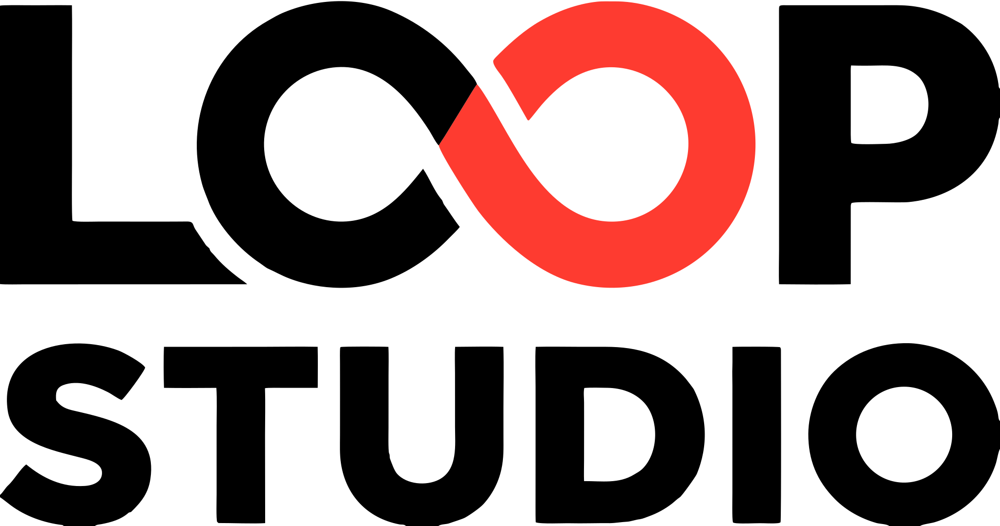
</picture>

<br><br>

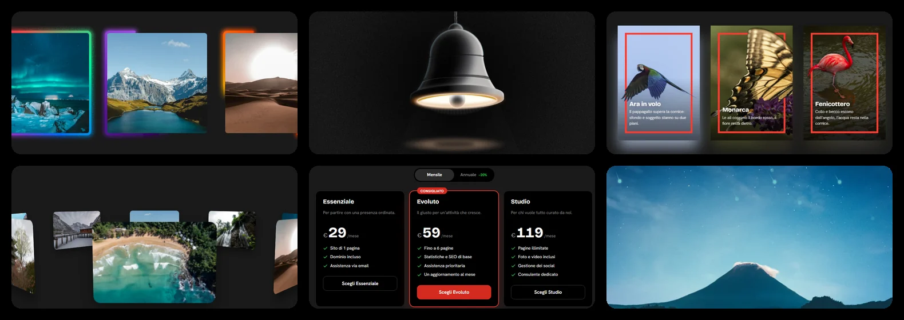

# Loop Studio Lab

**Front-end demos and UI components,<br>kept small, self-contained and a little bit playful.**

[](https://loop-studio-web.github.io/lab/) [](#components) [](#demos) [](#how-every-piece-is-built) [](#how-every-piece-is-built)

[**Open the Lab →**](https://loop-studio-web.github.io/lab/)

<sub>No build step: open any page and it runs.</sub>

</div>

<br>

## What this is

A sandbox. Before an idea goes into a client project, it lives here first: a slider with an odd effect, a toast that behaves, a booking widget that actually books. Nothing is a framework, nothing is a design system. Each folder is one demo you can open on its own.

The Lab is plain static files served as-is by GitHub Pages, so there is **no build step** in this repo: open a folder's `index.html` and it works. The studio's own site presents the same pages at [theloopstudio.org/lab](https://theloopstudio.org/lab/), with a miniature for each and a *Try it live* window that frames the page you see here.

> [!NOTE]
> The demo pages are written in Italian, because that is the language of the sites they are made for. Photos, films and brand names that appear in some of them are there for demonstration only (see [Notes](#notes)).

**Jump to:** [Components](#components) · [Demos](#demos) · [How every piece is built](#how-every-piece-is-built) · [The shared foundation](#the-shared-foundation) · [Using it](#using-it) · [Notes](#notes)

<br>

## Components

Twenty-nine demo pages in [`components/`](components), one folder each. Most gather several variants of the same idea, so there are well over a hundred small pieces in all. Every page opens on its own, on a fixed dark stage, with real buttons, keyboard and touch support, and `prefers-reduced-motion` respected. Click any picture to open the live page.

### Layout

*How a section is organised.*

<table>
  <tr>
    <td width="34%" valign="top"><a href="https://loop-studio-web.github.io/lab/components/bento-spotlight/">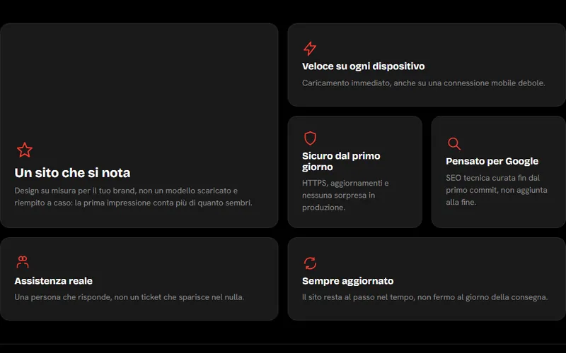</a></td>
    <td valign="top"><b><a href="https://loop-studio-web.github.io/lab/components/bento-spotlight/">Bento Spotlight</a></b><br>A bento grid (tiles of different sizes) with a light that follows the cursor across every tile. A 2026 pattern for "why choose us" sections and service overviews. It also has its own repository, <a href="https://github.com/Loop-Studio-Web/bento-spotlight">bento-spotlight</a>.<br><sub><a href="components/bento-spotlight">source</a></sub></td>
  </tr>
  <tr>
    <td width="34%" valign="top"><a href="https://loop-studio-web.github.io/lab/components/prezzi-toggle/">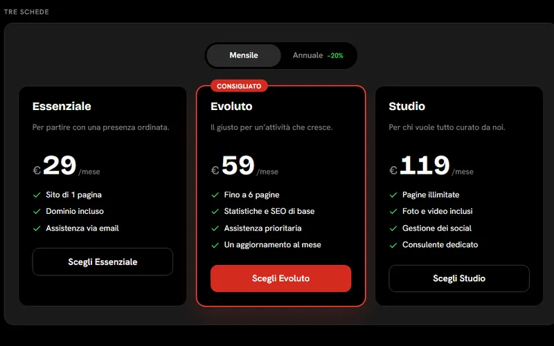</a></td>
    <td valign="top"><b><a href="https://loop-studio-web.github.io/lab/components/prezzi-toggle/">Pricing with a toggle</a></b><br>Monthly or yearly prices with a single switch, in three layouts.<br><sub><b>Variants:</b> three cards · comparison table · row list</sub><br><sub><a href="components/prezzi-toggle">source</a></sub></td>
  </tr>
  <tr>
    <td width="34%" valign="top"><a href="https://loop-studio-web.github.io/lab/components/stepper-timeline/">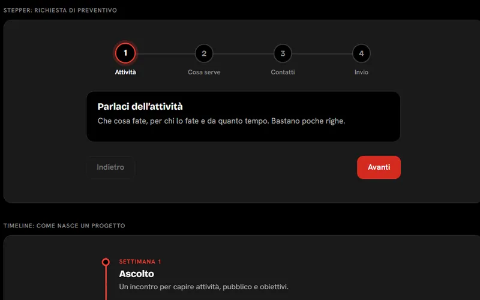</a></td>
    <td valign="top"><b><a href="https://loop-studio-web.github.io/lab/components/stepper-timeline/">Stepper and timeline</a></b><br>A stepper for a multi-step quote request, and a timeline that tells how a project is born.<br><sub><b>Variants:</b> quote-request stepper · project timeline</sub><br><sub><a href="components/stepper-timeline">source</a></sub></td>
  </tr>
</table>

### Navigation

*How people move around.*

<table>
  <tr>
    <td width="34%" valign="top"><a href="https://loop-studio-web.github.io/lab/components/sticky-navbar/">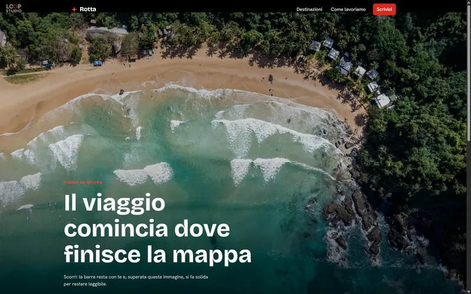</a></td>
    <td valign="top"><b><a href="https://loop-studio-web.github.io/lab/components/sticky-navbar/">Sticky navbar</a></b><br>A bar that stays fixed while you scroll and changes style once you leave the hero.<br><sub><a href="components/sticky-navbar">source</a></sub></td>
  </tr>
  <tr>
    <td width="34%" valign="top"><a href="https://loop-studio-web.github.io/lab/components/hamburger/">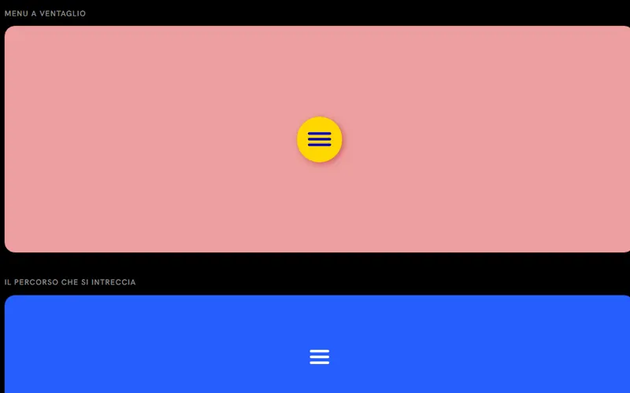</a></td>
    <td valign="top"><b><a href="https://loop-studio-web.github.io/lab/components/hamburger/">Hamburger</a></b><br>The menu button, transformed.<br><sub><b>Variants:</b> fan menu · a path that weaves · neon three lines · ten small transformations</sub><br><sub><a href="components/hamburger">source</a></sub></td>
  </tr>
  <tr>
    <td width="34%" valign="top"><a href="https://loop-studio-web.github.io/lab/components/tab-segmented/">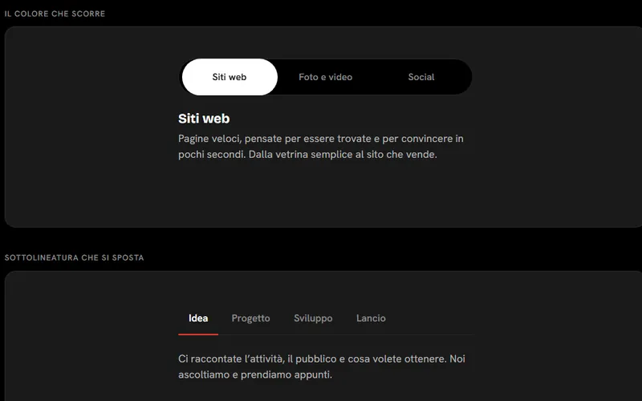</a></td>
    <td valign="top"><b><a href="https://loop-studio-web.github.io/lab/components/tab-segmented/">Tabs and segmented controls</a></b><br>Three ways to choose a view.<br><sub><b>Variants:</b> colour that slides · underline that moves · pills with icon</sub><br><sub><a href="components/tab-segmented">source</a></sub></td>
  </tr>
  <tr>
    <td width="34%" valign="top"><a href="https://loop-studio-web.github.io/lab/components/menu-hover/">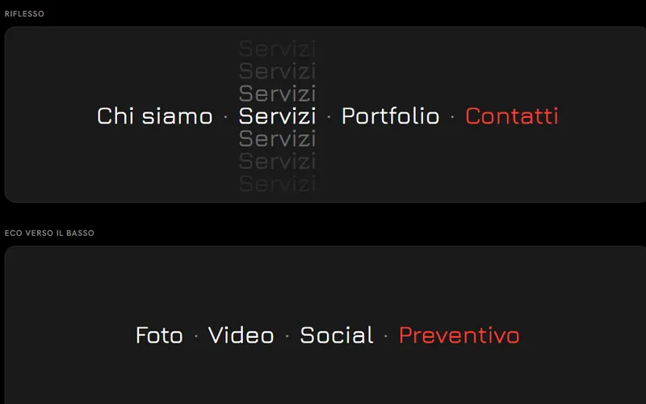</a></td>
    <td valign="top"><b><a href="https://loop-studio-web.github.io/lab/components/menu-hover/">Menu with reflection</a></b><br>Menu items that leave a reflection on hover or focus.<br><sub><b>Variants:</b> reflection · echo downwards · glow</sub><br><sub><a href="components/menu-hover">source</a></sub></td>
  </tr>
</table>

### Interaction

*Small things people press.*

<table>
  <tr>
    <td width="34%" valign="top"><a href="https://loop-studio-web.github.io/lab/components/bottoni/">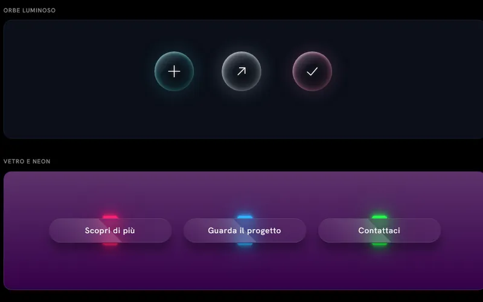</a></td>
    <td valign="top"><b><a href="https://loop-studio-web.github.io/lab/components/bottoni/">Buttons</a></b><br>Five buttons, each with a character of its own.<br><sub><b>Variants:</b> glowing orb · glass and neon · steampunk · vector frame · wild west</sub><br><sub><a href="components/bottoni">source</a></sub></td>
  </tr>
  <tr>
    <td width="34%" valign="top"><a href="https://loop-studio-web.github.io/lab/components/interruttori/">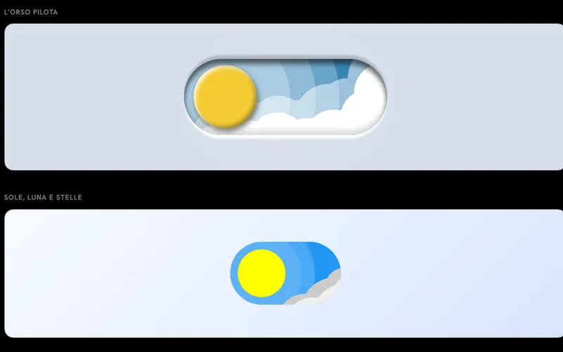</a></td>
    <td valign="top"><b><a href="https://loop-studio-web.github.io/lab/components/interruttori/">Switches</a></b><br>Five light/dark switches, from the barest to a bear pilot and a robot that never switches off. The theme really changes here.<br><sub><b>Variants:</b> bear pilot · sun, moon and stars · robot that never switches off · with icons · the essentials</sub><br><sub><a href="components/interruttori">source</a></sub></td>
  </tr>
  <tr>
    <td width="34%" valign="top"><a href="https://loop-studio-web.github.io/lab/components/like/">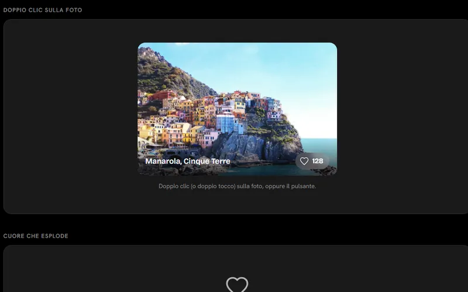</a></td>
    <td valign="top"><b><a href="https://loop-studio-web.github.io/lab/components/like/">Like</a></b><br>The "like" in seven versions, with a counter.<br><sub><b>Variants:</b> double click on the photo · exploding heart · heart with sparks (no images, no JS for the effect) · swinging heart · scrolling counter · rising hearts · "smash that like"</sub><br><sub><a href="components/like">source</a></sub></td>
  </tr>
</table>

### Forms

*Getting input without friction.*

<table>
  <tr>
    <td width="34%" valign="top"><a href="https://loop-studio-web.github.io/lab/components/campi-testo/">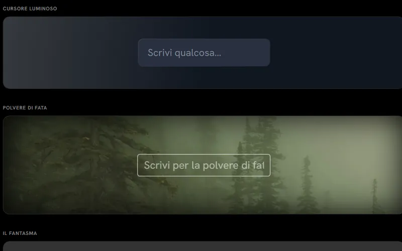</a></td>
    <td valign="top"><b><a href="https://loop-studio-web.github.io/lab/components/campi-testo/">Text fields</a></b><br>Seven fields with character.<br><sub><b>Variants:</b> glowing cursor · fairy dust · the ghost · from lens to cursor · rising label · six-digit code · password</sub><br><sub><a href="components/campi-testo">source</a></sub></td>
  </tr>
  <tr>
    <td width="34%" valign="top"><a href="https://loop-studio-web.github.io/lab/components/stelle-voto/">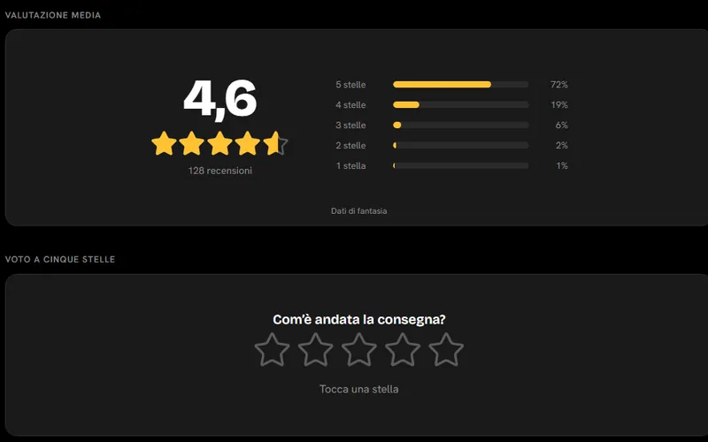</a></td>
    <td valign="top"><b><a href="https://loop-studio-web.github.io/lab/components/stelle-voto/">Star ratings</a></b><br>Average rating, five-star vote and half stars, all usable with keyboard and screen reader.<br><sub><b>Variants:</b> average rating · five-star vote · half stars</sub><br><sub><a href="components/stelle-voto">source</a></sub></td>
  </tr>
  <tr>
    <td width="34%" valign="top"><a href="https://loop-studio-web.github.io/lab/components/orario-arco/">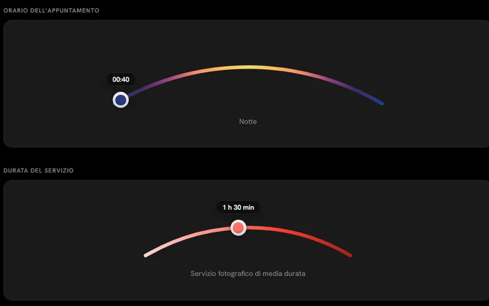</a></td>
    <td valign="top"><b><a href="https://loop-studio-web.github.io/lab/components/orario-arco/">Arc time picker</a></b><br>Pick the time of an appointment or the length of a service by dragging along an arc. Two instances of the same code.<br><sub><b>Variants:</b> appointment time · service duration</sub><br><sub><a href="components/orario-arco">source</a></sub></td>
  </tr>
</table>

### Cards

*Content that behaves like an object.*

<table>
  <tr>
    <td width="34%" valign="top"><a href="https://loop-studio-web.github.io/lab/components/card/">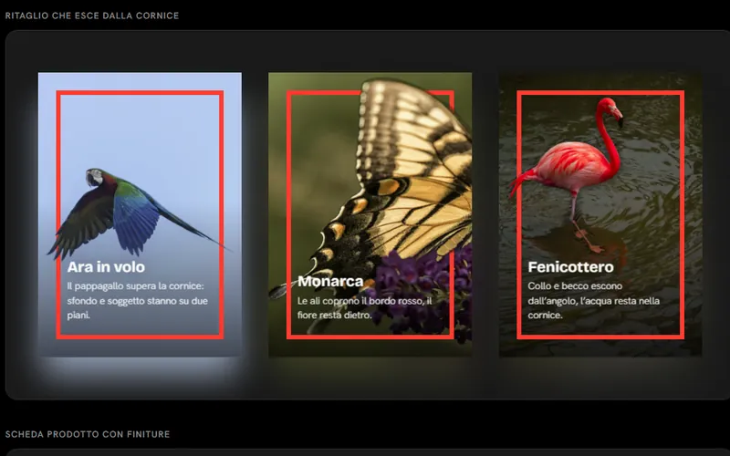</a></td>
    <td valign="top"><b><a href="https://loop-studio-web.github.io/lab/components/card/">Cards</a></b><br>Five ways to make a card feel like a physical thing.<br><sub><b>Variants:</b> cut-out that steps out of the frame · product card with finishes · tilt with raised product · tilt with reflection · ticket coming out of a slot</sub><br><sub><a href="components/card">source</a></sub></td>
  </tr>
  <tr>
    <td width="34%" valign="top"><a href="https://loop-studio-web.github.io/lab/components/flip-card/">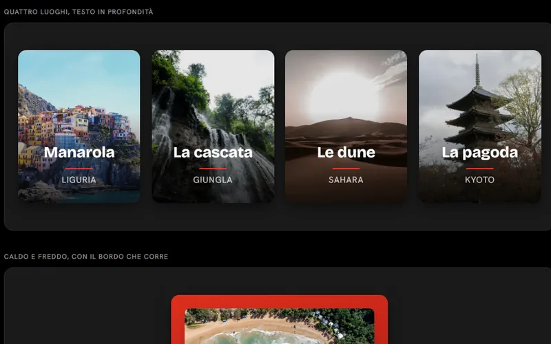</a></td>
    <td valign="top"><b><a href="https://loop-studio-web.github.io/lab/components/flip-card/">Flip cards</a></b><br>Cards that turn in 3D.<br><sub><b>Variants:</b> four places, text in depth · warm and cold, with a running border</sub><br><sub><a href="components/flip-card">source</a></sub></td>
  </tr>
</table>

### Feedback

*Telling people what is happening.*

<table>
  <tr>
    <td width="34%" valign="top"><a href="https://loop-studio-web.github.io/lab/components/toast-notification/">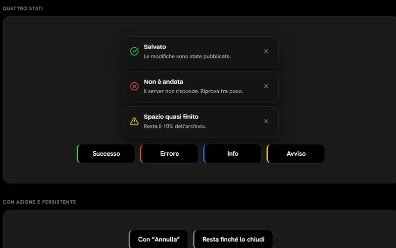</a></td>
    <td valign="top"><b><a href="https://loop-studio-web.github.io/lab/components/toast-notification/">Toast</a></b><br>Pop-up notifications with four states and a progress bar that pauses on hover or focus, plus a version with an action and a persistent one.<br><sub><b>Variants:</b> four states · with action · persistent</sub><br><sub><a href="components/toast-notification">source</a></sub></td>
  </tr>
  <tr>
    <td width="34%" valign="top"><a href="https://loop-studio-web.github.io/lab/components/loader/">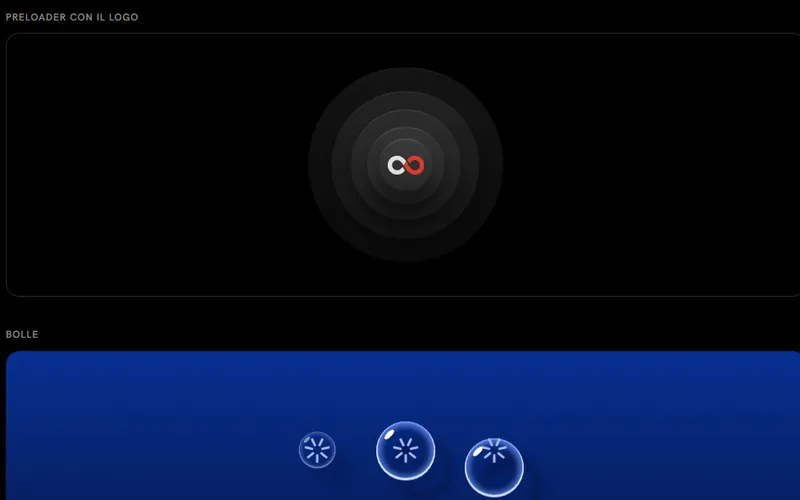</a></td>
    <td valign="top"><b><a href="https://loop-studio-web.github.io/lab/components/loader/">Loaders and progress</a></b><br>Seven ways to make people wait gracefully.<br><sub><b>Variants:</b> logo preloader · bubbles · coffee cup · dots · stack of cards · progress ring · loading bar</sub><br><sub><a href="components/loader">source</a></sub></td>
  </tr>
  <tr>
    <td width="34%" valign="top"><a href="https://loop-studio-web.github.io/lab/components/cookie/">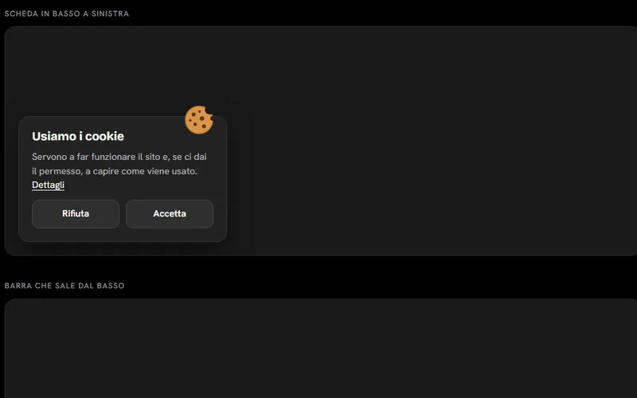</a></td>
    <td valign="top"><b><a href="https://loop-studio-web.github.io/lab/components/cookie/">Cookie notice</a></b><br>Three ways to ask for consent without ruining the page.<br><sub><b>Variants:</b> card bottom left · bar that rises from the bottom · window with preferences</sub><br><sub><a href="components/cookie">source</a></sub></td>
  </tr>
  <tr>
    <td width="34%" valign="top"><a href="https://loop-studio-web.github.io/lab/components/copia-appunti/">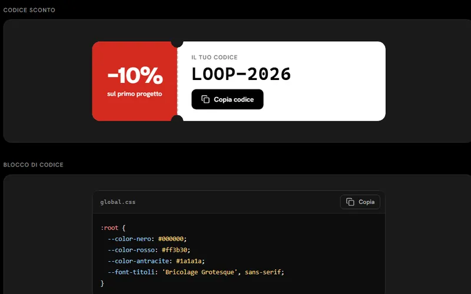</a></td>
    <td valign="top"><b><a href="https://loop-studio-web.github.io/lab/components/copia-appunti/">Copy to clipboard</a></b><br>One tap to copy, with the confirmation appearing on the spot. Falls back to <code>execCommand</code> where the Clipboard API is not allowed.<br><sub><b>Variants:</b> discount code · code block · contact details · link to share</sub><br><sub><a href="components/copia-appunti">source</a></sub></td>
  </tr>
</table>

### Effects

*Atmosphere: backgrounds, type and pointers.*

<table>
  <tr>
    <td width="34%" valign="top"><a href="https://loop-studio-web.github.io/lab/components/sfondi/">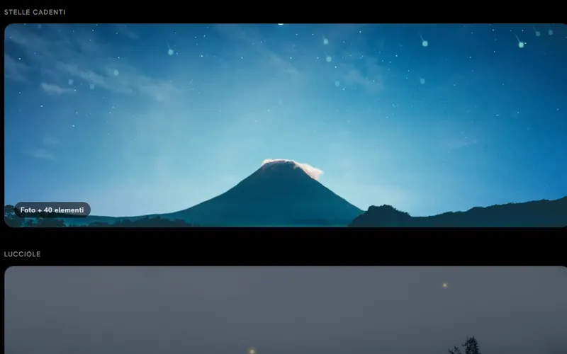</a></td>
    <td valign="top"><b><a href="https://loop-studio-web.github.io/lab/components/sfondi/">Animated backgrounds</a></b><br>Seven living backgrounds for a hero. Each one animates only while it is in view.<br><sub><b>Variants:</b> falling stars · fireflies · autumn leaves · rainbow rain · parallax stripes · concentric waves · diagonal illusion</sub><br><sub><a href="components/sfondi">source</a></sub></td>
  </tr>
  <tr>
    <td width="34%" valign="top"><a href="https://loop-studio-web.github.io/lab/components/effetti-testo/">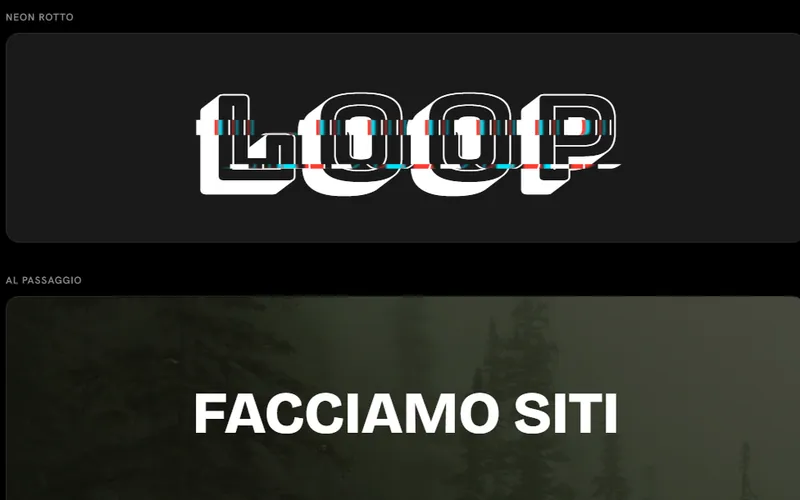</a></td>
    <td valign="top"><b><a href="https://loop-studio-web.github.io/lab/components/effetti-testo/">Text effects</a></b><br>Nine effects for headlines.<br><sub><b>Variants:</b> broken neon · on hover · reveal · glitch · soft shadow · stacked letters · bars sliding in · reassembling on scroll · round after round</sub><br><sub><a href="components/effetti-testo">source</a></sub></td>
  </tr>
  <tr>
    <td width="34%" valign="top"><a href="https://loop-studio-web.github.io/lab/components/cursori/">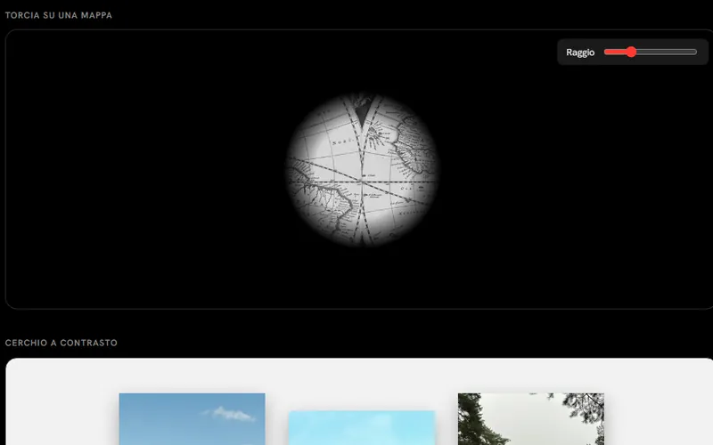</a></td>
    <td valign="top"><b><a href="https://loop-studio-web.github.io/lab/components/cursori/">Cursors</a></b><br>The pointer as part of the design.<br><sub><b>Variants:</b> torch on a map · contrast circle · play cursor on a video · cursor that changes with the element</sub><br><sub><a href="components/cursori">source</a></sub></td>
  </tr>
  <tr>
    <td width="34%" valign="top"><a href="https://loop-studio-web.github.io/lab/components/bordi-animati/">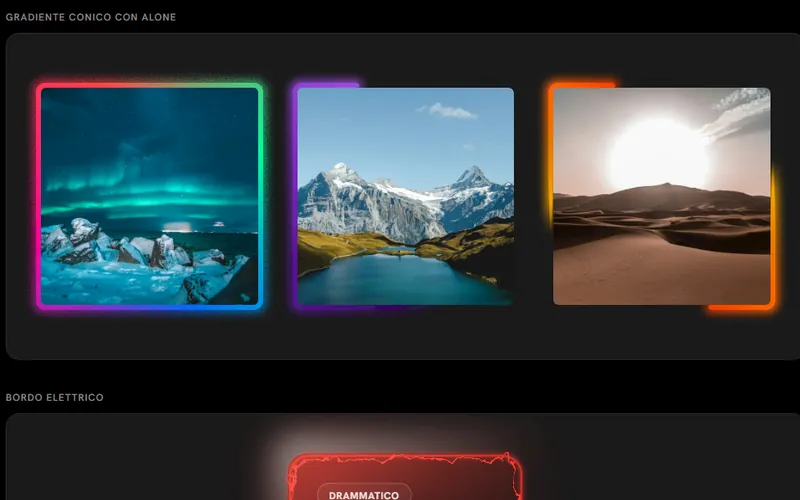</a></td>
    <td valign="top"><b><a href="https://loop-studio-web.github.io/lab/components/bordi-animati/">Animated borders</a></b><br>Three borders that move around a box. The glows animate only while they are in view.<br><sub><b>Variants:</b> conic gradient with glow · electric border · marker stroke</sub><br><sub><a href="components/bordi-animati">source</a></sub></td>
  </tr>
  <tr>
    <td width="34%" valign="top"><a href="https://loop-studio-web.github.io/lab/components/campanella/">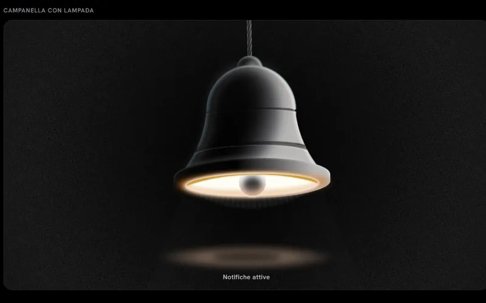</a></td>
    <td valign="top"><b><a href="https://loop-studio-web.github.io/lab/components/campanella/">Bell</a></b><br>A luminous bell that rings on click, also in a small navbar version with a notification counter.<br><sub><b>Variants:</b> bell with lamp · navbar bell</sub><br><sub><a href="components/campanella">source</a></sub></td>
  </tr>
</table>

### Gallery and media

*Showing images and video.*

<table>
  <tr>
    <td width="34%" valign="top"><a href="https://loop-studio-web.github.io/lab/components/rotating-image-gallery/">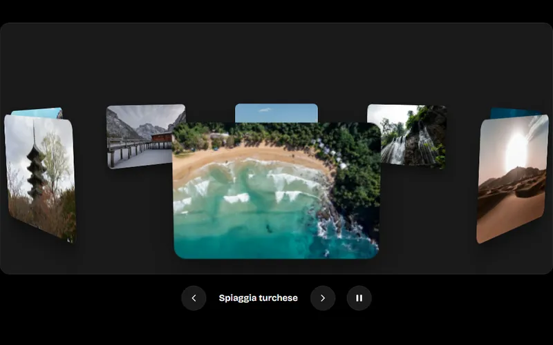</a></td>
    <td valign="top"><b><a href="https://loop-studio-web.github.io/lab/components/rotating-image-gallery/">Rotating 3D gallery</a></b><br>Images laid out in a 3D circle, rotated with the previous/next buttons or the keyboard.<br><sub><a href="components/rotating-image-gallery">source</a></sub></td>
  </tr>
  <tr>
    <td width="34%" valign="top"><a href="https://loop-studio-web.github.io/lab/components/galleria-fisarmonica/">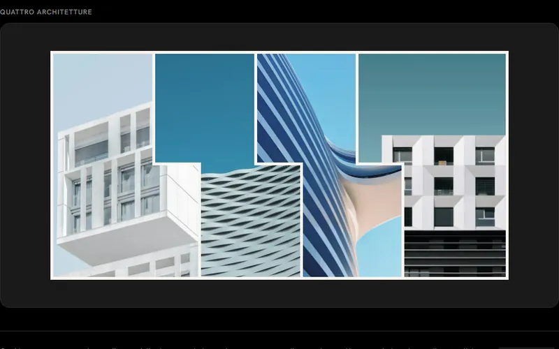</a></td>
    <td valign="top"><b><a href="https://loop-studio-web.github.io/lab/components/galleria-fisarmonica/">Accordion gallery</a></b><br>Panels that widen on hover or touch, in four different architectures.<br><sub><b>Variants:</b> four architectures</sub><br><sub><a href="components/galleria-fisarmonica">source</a></sub></td>
  </tr>
  <tr>
    <td width="34%" valign="top"><a href="https://loop-studio-web.github.io/lab/components/video-trailer-popup/">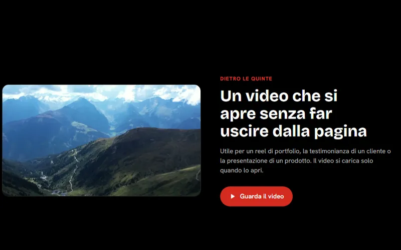</a></td>
    <td valign="top"><b><a href="https://loop-studio-web.github.io/lab/components/video-trailer-popup/">Video popup</a></b><br>A button that opens a full-screen video overlay without taking the visitor off the page. The video loads only when it is opened.<br><sub><a href="components/video-trailer-popup">source</a></sub></td>
  </tr>
  <tr>
    <td width="34%" valign="top"><a href="https://loop-studio-web.github.io/lab/components/marquee-loghi/">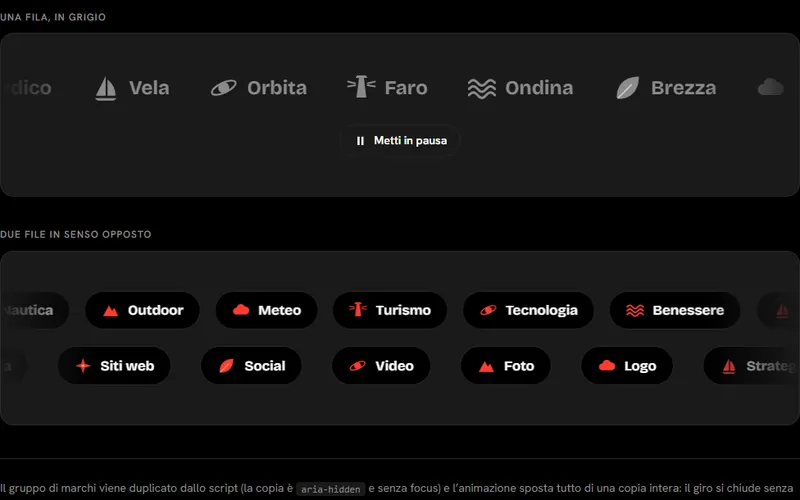</a></td>
    <td valign="top"><b><a href="https://loop-studio-web.github.io/lab/components/marquee-loghi/">Logo marquee</a></b><br>A row of logos that scrolls forever. It stops on hover and with the reduced-motion preference.<br><sub><b>Variants:</b> one grey row · two rows in opposite directions</sub><br><sub><a href="components/marquee-loghi">source</a></sub></td>
  </tr>
  <tr>
    <td width="34%" valign="top"><a href="https://loop-studio-web.github.io/lab/components/slider/">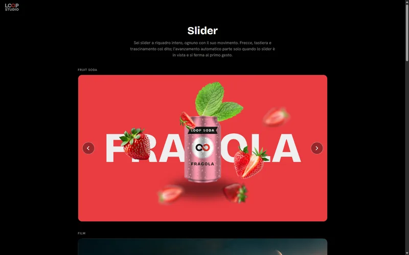</a></td>
    <td valign="top"><b><a href="https://loop-studio-web.github.io/lab/components/slider/">Sliders</a></b><br>Six full-width sliders, each with its own motion. They move with the arrows, the keyboard and a swipe, or turn by themselves while in view and stop at the first gesture.<br><sub><b>Variants:</b> fruit soda · film posters · fashion (vertical) · animals with thumbnails · coffee · rotating light</sub><br><sub><a href="components/slider">source</a></sub></td>
  </tr>
</table>

<br>

## Demos

Full pages and small apps, each in its own folder, each opening on its own: scroll-driven 3D scenes, widgets the studio built for clients, pages that talk to an external API through a small Worker. The studio site presents them in the Demo section of [/lab](https://theloopstudio.org/lab/), with a short technical note for each.

<table>
  <tr>
    <td width="33%" valign="top"><a href="https://loop-studio-web.github.io/lab/3d-medusa/">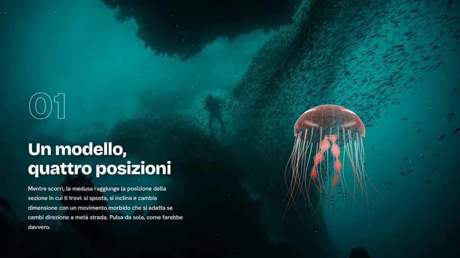</a><br><b><a href="https://loop-studio-web.github.io/lab/3d-medusa/">Jellyfish 3D scroll</a></b> &nbsp;<sub><code>Three.js · GLSL</code></sub><br><sub>A jellyfish built entirely in code that swims from one section to the next as you scroll. No 3D file to download.</sub></td>
    <td width="33%" valign="top"><a href="https://loop-studio-web.github.io/lab/3d-infinito/">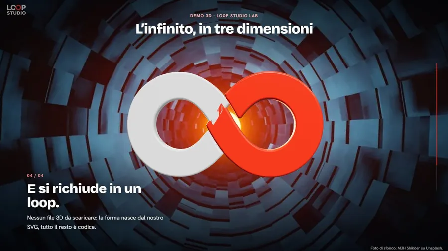</a><br><b><a href="https://loop-studio-web.github.io/lab/3d-infinito/">The infinity in 3D</a></b> &nbsp;<sub><code>Three.js · SVG</code></sub><br><sub>The studio mark built piece by piece: two extruded rings that open, interlock and close again. Scroll is the crank.</sub></td>
    <td width="33%" valign="top"><a href="https://loop-studio-web.github.io/lab/3d-farfalla/">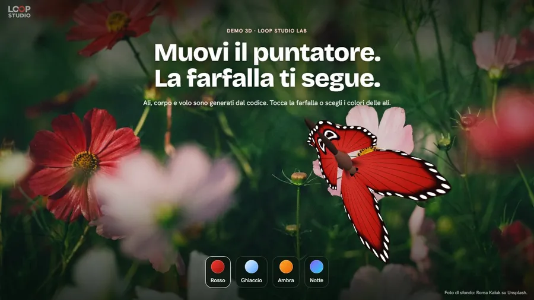</a><br><b><a href="https://loop-studio-web.github.io/lab/3d-farfalla/">Interactive butterfly</a></b> &nbsp;<sub><code>Three.js · GLSL</code></sub><br><sub>A butterfly that follows your pointer and flies on its own when you stop. Pick the colours of the wings.</sub></td>
  </tr>
  <tr>
    <td width="33%" valign="top"><a href="https://loop-studio-web.github.io/lab/storytelling-css/">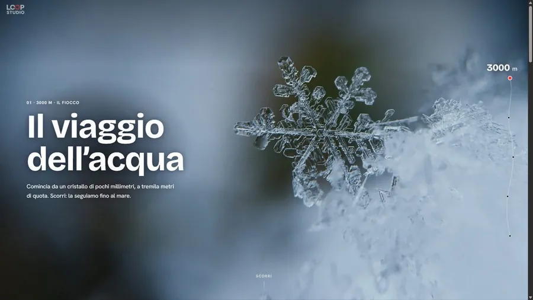</a><br><b><a href="https://loop-studio-web.github.io/lab/storytelling-css/">Scroll storytelling</a></b> &nbsp;<sub><code>CSS only</code></sub><br><sub>A story told while you scroll, in pure CSS: one named timeline, a sticky stage and a path to follow. It falls back to a stacked page where scroll-driven animation is missing.</sub></td>
    <td width="33%" valign="top"><a href="https://loop-studio-web.github.io/lab/galleria-trascinabile/">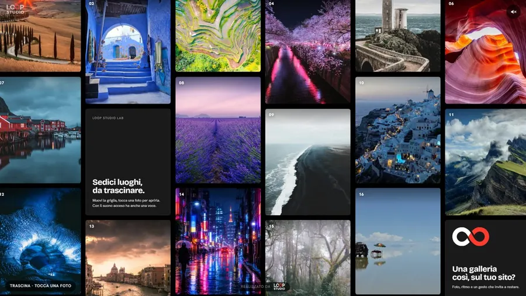</a><br><b><a href="https://loop-studio-web.github.io/lab/galleria-trascinabile/">Draggable gallery</a></b> &nbsp;<sub><code>GSAP · Draggable · Web Audio</code></sub><br><sub>Photo tiles you drag, throw and open full size, with inertia and an optional sound. A showpiece, and honest about it.</sub></td>
    <td width="33%" valign="top"><a href="https://loop-studio-web.github.io/lab/galleria-riordinabile/">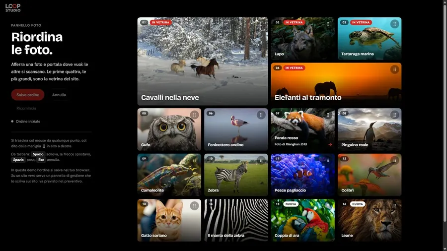</a><br><b><a href="https://loop-studio-web.github.io/lab/galleria-riordinabile/">Reorderable gallery</a></b> &nbsp;<sub><code>GSAP Flip · CSS Grid</code></sub><br><sub>A mosaic whose shape depends on position: drag a photo to the front and it becomes the big one. Mouse, touch and keyboard, with a full-screen presentation.</sub></td>
  </tr>
  <tr>
    <td width="33%" valign="top"><a href="https://loop-studio-web.github.io/lab/booking-widget/">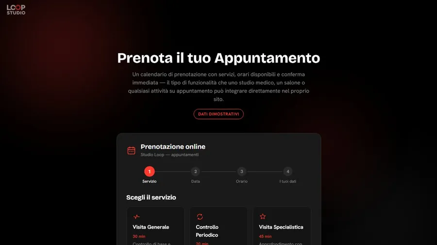</a><br><b><a href="https://loop-studio-web.github.io/lab/booking-widget/">Booking widget</a></b> &nbsp;<sub><code>React</code></sub><br><sub>An appointment booking flow in steps, starting from the choice of the service.</sub></td>
    <td width="33%" valign="top"><a href="https://loop-studio-web.github.io/lab/google-reviews-widget/">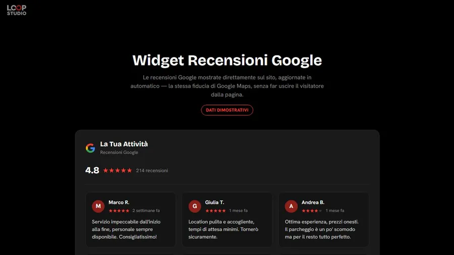</a><br><b><a href="https://loop-studio-web.github.io/lab/google-reviews-widget/">Reviews widget</a></b> &nbsp;<sub><code>React</code></sub><br><sub>A reviews carousel with sample data and a rating summary.</sub></td>
    <td width="33%" valign="top"><a href="https://loop-studio-web.github.io/lab/preventivatore/">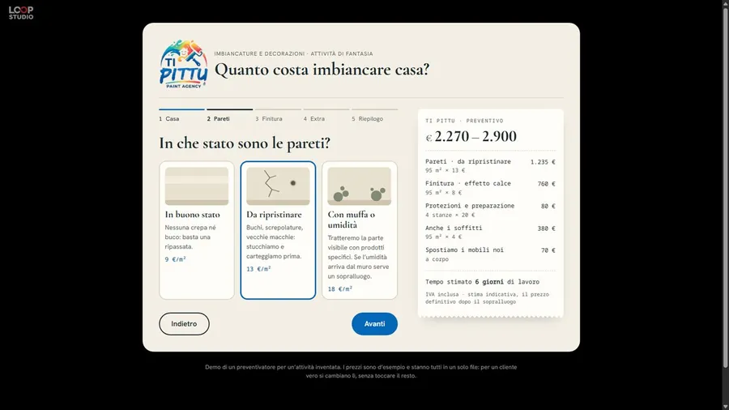</a><br><b><a href="https://loop-studio-web.github.io/lab/preventivatore/">Quote builder</a></b> &nbsp;<sub><code>React · Vite</code></sub><br><sub>A painter's quote that builds as you answer, with the price shown as a range on a receipt. Every number lives in one file; the choices live in the URL.</sub></td>
  </tr>
  <tr>
    <td width="33%" valign="top"><a href="https://loop-studio-web.github.io/lab/menu-su-misura/">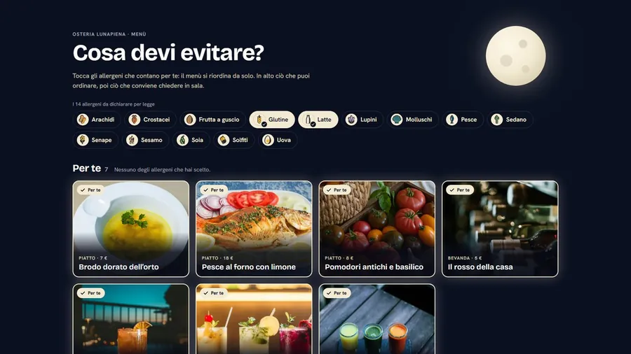</a><br><b><a href="https://loop-studio-web.github.io/lab/menu-su-misura/">Menu made for you</a></b> &nbsp;<sub><code>JS · GSAP Flip</code></sub><br><sub>A restaurant menu that reorders itself around the allergens you pick: "for you", "ask the waiter", "not for you", plus a card to show the waiter.</sub></td>
    <td width="33%" valign="top"><a href="https://loop-studio-web.github.io/lab/report-social/">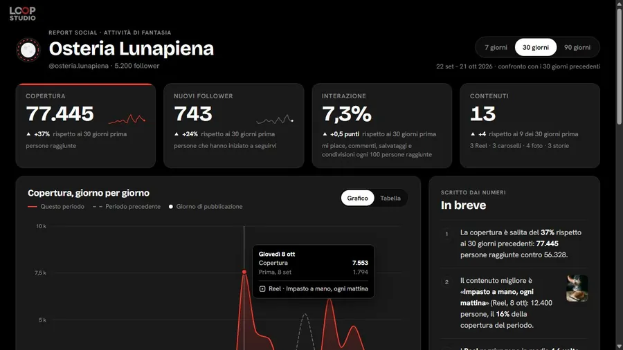</a><br><b><a href="https://loop-studio-web.github.io/lab/report-social/">Social report</a></b> &nbsp;<sub><code>SVG · JavaScript</code></sub><br><sub>A client report drawn in plain SVG and HTML, no chart library. The data is fake but shaped like the Instagram API's.</sub></td>
    <td width="33%" valign="top"><a href="https://loop-studio-web.github.io/lab/convertitore-valute/">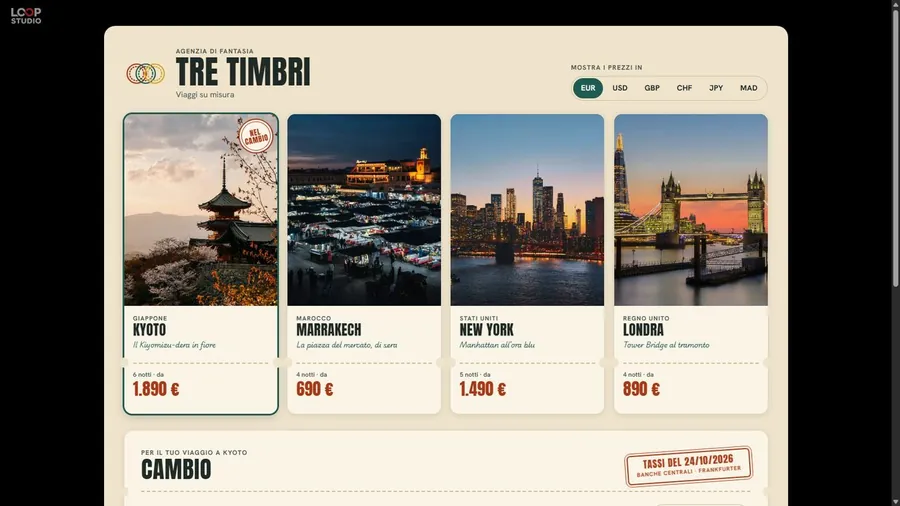</a><br><b><a href="https://loop-studio-web.github.io/lab/convertitore-valute/">Currency converter</a></b> &nbsp;<sub><code>JS · Cloudflare Worker</code></sub><br><sub>Prices on postcards in the visitor's currency, a converter and a 30/90-day chart. The rates come from a small Worker of ours, never from the browser.</sub></td>
  </tr>
  <tr>
    <td width="33%" valign="top"><a href="https://loop-studio-web.github.io/lab/faq-ricerca/">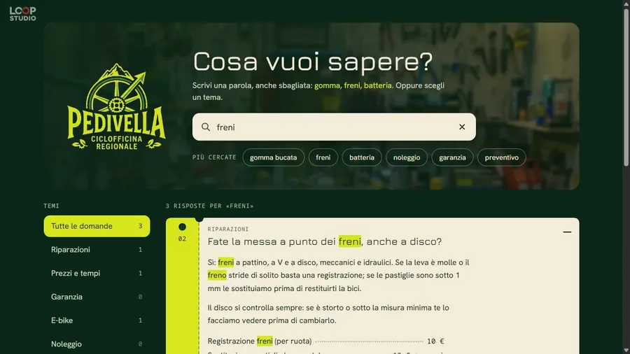</a><br><b><a href="https://loop-studio-web.github.io/lab/faq-ricerca/">FAQ with search</a></b> &nbsp;<sub><code>JS · Highlight API</code></sub><br><sub>A search that understands synonyms and typos, highlights what it found, filters by topic and links straight to every answer.</sub></td>
    <td width="33%" valign="top"><a href="https://loop-studio-web.github.io/lab/skyTracker/">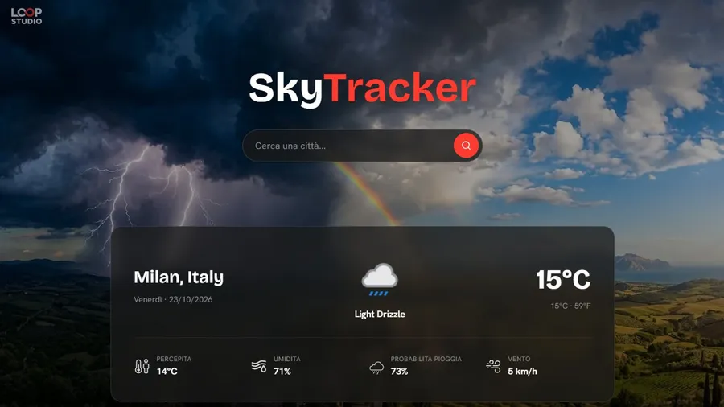</a><br><b><a href="https://loop-studio-web.github.io/lab/skyTracker/">SkyTracker</a></b> &nbsp;<sub><code>JS · Cloudflare Worker</code></sub><br><sub>A weather app: city search and a three-day forecast, through a small Worker that keeps the key secret.</sub></td>
    <td width="33%" valign="top"><a href="https://loop-studio-web.github.io/lab/calendario/">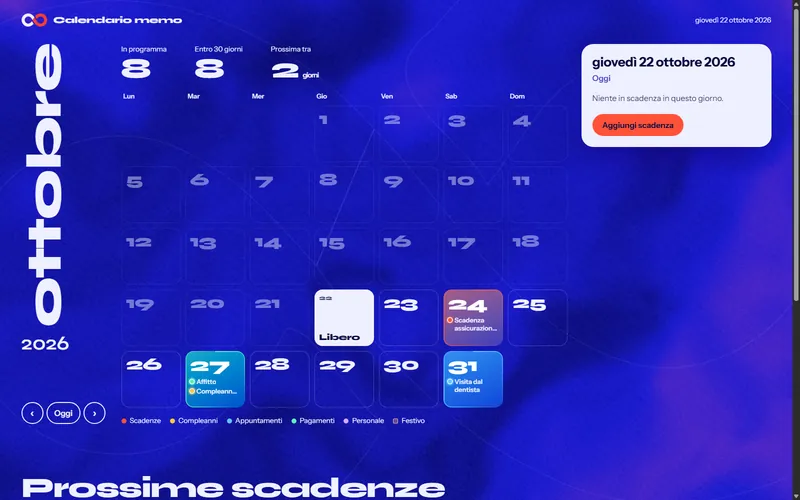</a><br><b><a href="https://loop-studio-web.github.io/lab/calendario/">Calendario</a></b> &nbsp;<sub><code>Astro · WebGL</code></sub><br><sub>A memo calendar with a hand-written WebGL background. Events stay in your browser. Build only; sources live in a private repository.</sub></td>
  </tr>
</table>

<sub>Sources not in this repository (only the compiled builds are published): <code>calendario</code>, <code>booking-widget</code>, <code>google-reviews-widget</code> and <code>preventivatore</code>, kept in private repositories. The Workers behind <code>skyTracker</code> and <code>convertitore-valute</code> are private repositories too: no API key ever reaches the browser. The demos' businesses (Osteria Lunapiena, Tre Timbri, Pedivella, Ti Pittu) are made up, and so are their names, prices and data.</sub>

<br>

## How every piece is built

The rules every component page follows. They are the part worth copying.

| Rule | In practice |
|---|---|
| **Self-contained** | One folder per demo (`index.html`, usually with its own CSS and JS). No Tailwind, no jQuery, no CDN, no icon fonts, no Google Fonts: fonts are self-hosted and open-licensed. |
| **Real controls** | Real `<button>`s, `aria-expanded` / `aria-pressed`, keyboard and touch. Modals use the native `<dialog>`. Hover effects only where there is a real hover (`@media (hover: hover) and (pointer: fine)`), and a pressed state on touch. |
| **Motion with manners** | `prefers-reduced-motion` always honoured. Continuous or heavy animations run **only while their section is in view** (an `IntersectionObserver` flips an `.is-live` class; out of view they pause). Never `transition: all`. |
| **Repeated things are generated** | Stars, leaves, columns and the like are produced by JS from a seeded generator (mulberry32), not copied by hand, so they are reproducible and cheap to change. |
| **Fits the frame** | Each page works inside the studio site's *Try it live* window (about 70rem by 85vh) and as a small miniature, with the strongest section first. Units follow the box (`container-type: size`, `cqw`/`cqh`), not the window. |
| **Measured** | After every deploy, on the live pages: **axe-core 0 violations** on all 28 component pages and on all 15 demo pages, and on the studio's [/lab page](https://theloopstudio.org/lab/) that presents them. **PageSpeed mobile 98 to 100** on the sample components (97 on the /lab page), accessibility 100, **CLS 0**. Demos (23 October 2026): 87 to 100 on 12 of 15; the three Three.js scenes score lower (35 to 78) because PageSpeed draws WebGL in software, which shows up as a huge blocking time that a phone with a GPU does not have. |

<br>

## The shared foundation

Everything shared lives in [`components/_shared/`](components/_shared), so a new page starts small.

```
components/
├── _shared/
│   ├── base.css        → variables, reset, the demo/stage layout, reduced-motion rule
│   ├── studio.js/.css  → the small "made by Loop Studio" signature on every page
│   ├── fonts/          → Bricolage Grotesque, Hanken Grotesk, Anton, Jura, Cormorant Garamond, Noto Sans Mono, Playwrite IS (OFL)
│   ├── three/, gsap/   → the small libraries some demos share (Three.js r129, GSAP core + plugins)
│   └── img/            → the pool of photographs the demos share (WebP)
└── <component>/
    ├── index.html
    ├── style.css
    └── script.js
```

The signature is one component, `studio.js`: a page adds a single `<script>` tag and gets the small logo at the top and the "made by" line at the bottom, both linking to the studio's site. It is never copied into pages by hand.

<br>

## Using it

```bash
git clone https://github.com/Loop-Studio-Web/lab.git
cd lab
# open any folder's index.html, or serve the root:
npx serve .
```

## Notes

- Some pieces show third-party photos, films or brand names **for demonstration only**. They keep their own licences and owners; see [LICENSE](LICENSE). Stock photos come from Unsplash and Pexels, under their licences. A few images (some logos, the allergen icons) were generated with AI; each page that uses one says so.
- The code is published so you can read it and learn from it. It is **not open source**: reuse needs written permission, which you can ask for at [theloopstudio.org/contatti](https://theloopstudio.org/contatti/).
- The finished, full-page work lives in a sibling repo: [**vetrine**](https://github.com/Loop-Studio-Web/vetrine).

<br>

---

<div align="center"><sub>Built by <a href="https://theloopstudio.org">Loop Studio</a> · web design, photo &amp; video, social</sub></div>
